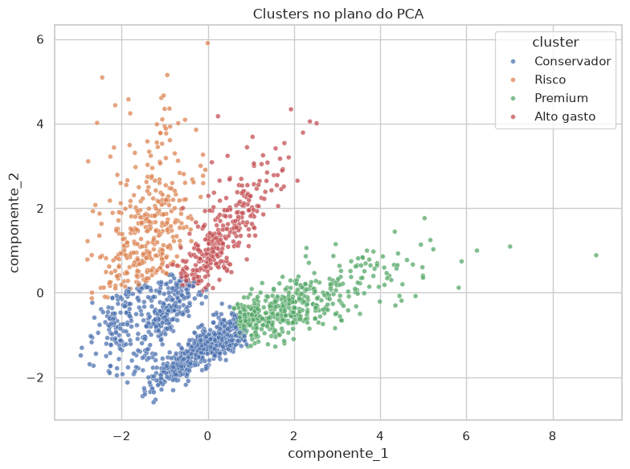
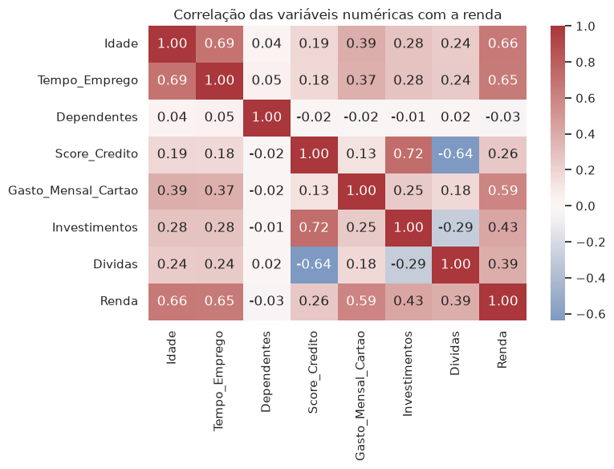
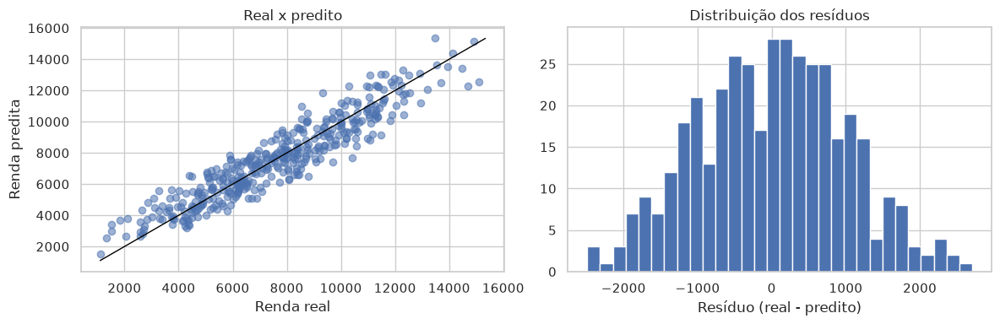
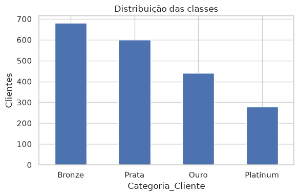
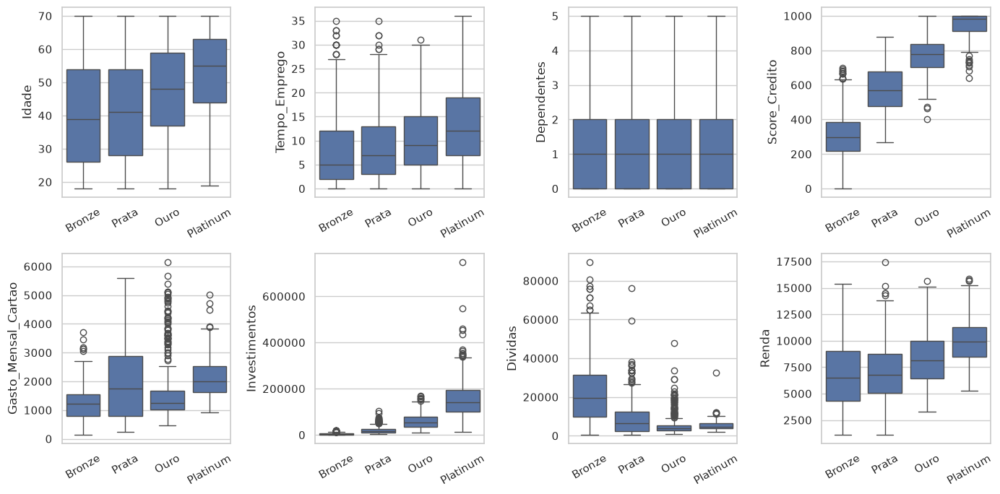
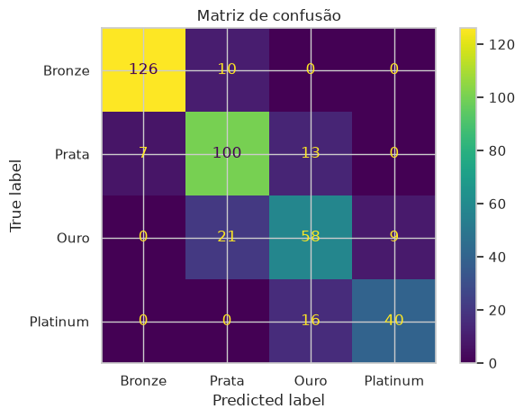
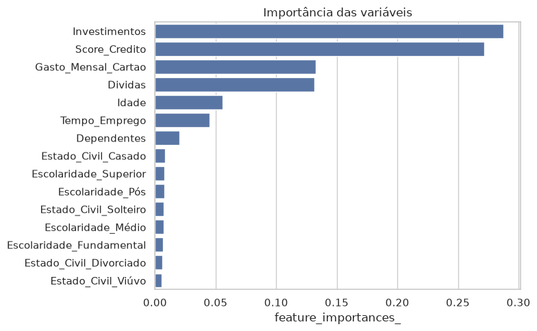
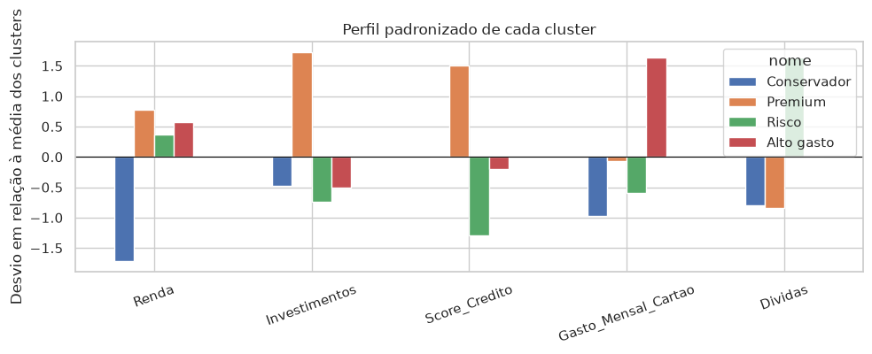

# Desafio prático: Inteligência de Negócios com Machine Learning

<p align="center">
  <a href="https://anchieta.br/pos-graduacao-ead/machine-learning/"></a>
</p>

Três modelos para 2.000 clientes de uma instituição financeira fictícia.
A renda usa regressão linear, a categoria uma floresta aleatória e a segmentação K-Means.
A base é fictícia: as métricas medem este exercício, não um sistema em produção.

| Renda | Categoria | Segmentação |
|---|---|---|
| **R² 0,873** | **f1_macro 0,790** | **silhouette 0,393** |
| RMSE R$ 995,63 · MAE R$ 808,95 | 4 classes, split estratificado | k = 4 · Premium, Risco, Alto gasto, Conservador |

<p align="center">
  
</p>
<p align="center"><sub>Segmentos no plano do PCA. O gráfico é só leitura: o modelo salvo é o K-Means nas cinco variáveis financeiras.</sub></p>

## O projeto

Desafio prático da [Pós Graduação em Machine Learning](https://anchieta.br/pos-graduacao-ead/machine-learning/), do [UniAnchieta](https://anchieta.br/) com a [Faculdade de Tecnologia Rocketseat](https://www.rocketseat.com.br/faculdade). A trilha percorre estatística, análise exploratória, aprendizado de máquina, algoritmos supervisionados, clusterização e ensemble. Este repositório junta esse percurso nas três perguntas da tabela abaixo.

| Sistema | Pergunta de negócio | Tipo | Notebook | Modelo salvo |
|---|---|---|---|---|
| Estimar a renda mensal | Quanto essa pessoa ganha? | Regressão | `desafio_1_renda.ipynb` | `modelo_renda.pkl` |
| Classificar a categoria | Em qual prateleira de oferta ela entra? | Classificação em 4 classes | `desafio_2_categoria.ipynb` | `modelo_categoria.pkl` |
| Segmentar a base | Que grupos naturais existem além do rótulo oficial? | Clusterização | `desafio_3_segmentacao.ipynb` | `modelo_segmentacao.pkl` |

A renda cobre o prospect cuja renda ainda não é conhecida. A categoria usa o rótulo que o banco já atribui (Bronze, Prata, Ouro, Platinum) para escolher a oferta. A segmentação ignora esse rótulo e agrupa pelo comportamento financeiro, para definir a mensagem da campanha. Dois clientes Ouro podem cair em grupos diferentes.

## Estrutura

```
datasets/
└── clientes.csv
desafio_1_renda.ipynb
desafio_2_categoria.ipynb
desafio_3_segmentacao.ipynb
README.md
```

Cada notebook segue a mesma espinha, em seções separadas, com nomes descritivos e um markdown explicando a decisão da etapa:

1. Contexto do desafio.
2. Carga de `datasets/clientes.csv`.
3. Exploração.
4. Pré-processamento.
5. Modelagem.
6. Avaliação.
7. Gravação do modelo com `joblib.dump`.
8. Conclusões, com as métricas pedidas e a leitura de negócio.

Os arquivos `modelo_*.pkl` nascem quando o notebook roda. O que a avaliação confere é o `joblib.dump` com o nome exato. Os `.pkl` não entram no repositório.

Ambiente: Python 3.12, no Jupyter local ou no Google Colab. Bibliotecas: `pandas`, `matplotlib`, `seaborn`, `scipy`, `scikit-learn`, `optuna`, `joblib` e `jupyter`. As versões estão em `requirements.txt`. O notebook roda a partir da raiz do repositório, porque a leitura é exatamente `datasets/clientes.csv`.

No Colab, a pasta de trabalho precisa ser a que contém `datasets/`. Em cada notebook, as células rodam de cima para baixo, uma vez, sem reordenar. A instalação está em [Como executar](#como-executar).

`random_state=42` fica fixo em todo split, floresta, K-Means e busca. O split supervisionado é 80% treino e 20% teste.

## A base

`datasets/clientes.csv` tem 2.000 linhas, 13 colunas e nenhum valor ausente. Os identificadores vão de 1 a 2.000. As classes da categoria são desbalanceadas: Bronze 680, Prata 600, Ouro 440 e Platinum 280. Por isso o Desafio 2 estratifica o split e avalia com `f1_macro`, que trata as quatro classes com o mesmo peso.

| Coluna | Tipo | Papel |
|---|---|---|
| `ID_Cliente` | inteiro | Identificador. Sai dos três modelos. |
| `Nome` | texto | Identificador. Sai dos três modelos. |
| `Idade` | inteiro, 18–70 | Feature nos Desafios 1 e 2. |
| `Escolaridade` | Fundamental, Médio, Superior, Pós | Feature nos Desafios 1 e 2. |
| `Tempo_Emprego` | inteiro, anos no emprego atual | Feature nos Desafios 1 e 2. |
| `Estado_Civil` | Solteiro, Casado, Divorciado, Viúvo | Feature nos Desafios 1 e 2. |
| `Dependentes` | inteiro, 0–5 | Feature nos Desafios 1 e 2. |
| `Score_Credito` | inteiro, 0–1000 | Feature nos três desafios. |
| `Gasto_Mensal_Cartao` | float, R$ | Feature nos três desafios. |
| `Investimentos` | float, R$ | Feature nos três desafios. |
| `Dividas` | float, R$ | Feature nos três desafios. |
| `Renda` | float, R$ | Alvo do Desafio 1. Feature do Desafio 3. Fora do Desafio 2. |
| `Categoria_Cliente` | Bronze, Prata, Ouro, Platinum | Alvo do Desafio 2. Fora dos Desafios 1 e 3. |

`Categoria_Cliente` fica fora da regressão mesmo o enunciado só obrigando a remoção de `ID_Cliente` e `Nome`. A categoria é um rótulo comercial, e a renda muda junto com ela. Usá-la para prever a renda tornaria os dois primeiros sistemas circulares: um recuperaria a renda pela categoria, o outro recuperaria a categoria por tudo menos a renda. A ANOVA da renda por categoria entra na exploração do Desafio 1 para deixar essa relação visível, e a coluna sai antes do split.

## Regra de pré-processamento

Encoder e scaler que aprendem com os dados entram num `Pipeline` e são ajustados só no treino. O `cross_val_score` e o `GridSearchCV` reajustam esse pipeline a cada fold. Transformar a base inteira antes do split vazaria o teste para dentro do treino.

No Desafio 3 não há split. O produto é a segmentação dos 2.000 clientes atuais, então o pipeline é ajustado na base inteira das cinco features.

O encoding das categóricas é `OneHotEncoder`. No Desafio 1, `drop="first"` evita a armadilha das dummies na regressão linear: cada coeficiente de categoria é a diferença contra a categoria de referência. No Desafio 2 a floresta recebe todas as dummies, com `handle_unknown="ignore"`. `Escolaridade` tem ordem, mas o espaçamento entre Fundamental, Médio, Superior e Pós não é igual. One-hot não impõe esse espaçamento.

## Desafio 1 — Predição de renda

Conteúdo usado: regressão linear múltipla, validação cruzada, resíduos e leitura de RMSE, MAE e R². O algoritmo entregue é `sklearn.linear_model.LinearRegression`.

### Exploração

- `info`, `head` e `describe`.
- Histograma de cada numérica, inclusive `Renda`.
- Matriz de correlação das numéricas, com a renda na matriz, para ver quais variáveis andam com o alvo.
- ANOVA (`scipy.stats.f_oneway`) da renda por `Escolaridade`, `Estado_Civil` e `Categoria_Cliente`. As duas primeiras são candidatas a feature. A terceira documenta por que a categoria sai do modelo.

### Pré-processamento e modelo

Saem `ID_Cliente`, `Nome` e `Categoria_Cliente`. O alvo é `Renda`.

As numéricas passam por `StandardScaler` e as categóricas por `OneHotEncoder(drop="first")`, os dois dentro de um `ColumnTransformer`, dentro do `Pipeline`, ajustados depois do `train_test_split`. O coeficiente de uma numérica é o efeito de um desvio-padrão, em reais. O coeficiente de uma categoria é a diferença, em reais, contra a categoria de referência omitida pelo `drop="first"` (Fundamental e Casado). A tabela ordena pela magnitude e a conclusão mantém essa diferença de escala.

### Avaliação

No teste, uma vez:

- RMSE, em reais.
- MAE, em reais.
- R².

No treino, `cross_val_score` com 5 folds e `scoring="r2"`. O número publicado é a média desses cinco R². A validação cruzada usa o pipeline, então cada fold reaprende scaler e encoder.

Dois gráficos de resíduo: dispersão do valor real contra o predito, e histograma de `real - predito`. Se os resíduos formarem curva ou leque, a conclusão registra o limite do modelo linear. O arquivo salvo continua sendo a regressão linear pedida.

Tabela dos coeficientes ordenada pelo valor absoluto, com o nome vindo de `get_feature_names_out`.

### Saída

`joblib.dump` grava `modelo_renda.pkl`. A conclusão comenta RMSE, MAE e R² do teste, o R² médio da validação cruzada e as variáveis de maior coeficiente. Referência de um modelo bem construído: R² no teste de pelo menos 0,70.

## Desafio 2 — Classificação da categoria

Conteúdo usado: classificação multiclasse, Random Forest, importância de variáveis e otimização de hiperparâmetros. O algoritmo entregue é `sklearn.ensemble.RandomForestClassifier`.

### Exploração

- Carga e visão inicial da base.
- `value_counts` da `Categoria_Cliente`, com gráfico de barras. A leitura já espera Bronze como classe mais frequente e Platinum como a menor.
- Boxplot de cada numérica por categoria.
- ANOVA (`f_oneway`) de cada numérica, inclusive `Renda`, contra a categoria. Essa ANOVA da renda mostra a associação que obriga a coluna a sair do modelo.
- Qui-quadrado (`scipy.stats.chi2_contingency`) de `Escolaridade` e `Estado_Civil` contra a categoria. `Dependentes` entra na ANOVA, porque é numérico.

### Pré-processamento e modelos

Saem `ID_Cliente`, `Nome` e `Renda`. O alvo é `Categoria_Cliente`.

O `train_test_split` usa `stratify=y`. Existem dois modelos, e a comparação é entre eles:

1. Baseline: `RandomForestClassifier` com os parâmetros padrão e `random_state=42`.
2. Modelo tunado: `GridSearchCV` no mesmo pipeline, com `StratifiedKFold` de 5 folds e `scoring="f1_macro"`. A grade cobre `n_estimators` em `[100, 200, 400]` e `max_depth` em `[None, 8, 16]`. `refit=True` reajusta o melhor conjunto no treino inteiro.

O `GridSearchCV` já é a validação cruzada estratificada pedida. O notebook mostra o `f1_macro` médio do baseline, obtido com `cross_val_score` nas mesmas 5 folds, ao lado do melhor score da busca. O teste entra só depois, no `classification_report` do modelo final.

### Avaliação

No teste do modelo tunado:

- `classification_report`, com precisão, recall e F1 de cada classe e o `f1_macro`.
- Matriz de confusão em gráfico.
- `feature_importances_` em gráfico, com os nomes das colunas depois do one-hot. A importância de `Escolaridade` fica repartida entre as dummies. A conclusão lê o bloco, e não uma dummy isolada, como se fosse a variável inteira.

### Saída

`joblib.dump` grava `modelo_categoria.pkl` com o pipeline escolhido na validação cruzada. A conclusão compara baseline e modelo tunado, informa o `f1_macro` no teste e aponta a classe de melhor desempenho e a de pior desempenho. Referência: `f1_macro` no teste de pelo menos 0,75.

## Desafio 3 — Segmentação

Conteúdo usado: K-Means e escolha de `k`. A clusterização hierárquica fica como repertório. O algoritmo entregue é `sklearn.cluster.KMeans` dentro de um `Pipeline`.

### Features

Entram só estas cinco colunas:

- `Renda`
- `Investimentos`
- `Score_Credito`
- `Gasto_Mensal_Cartao`
- `Dividas`

Ficam de fora `ID_Cliente`, `Nome`, `Categoria_Cliente`, `Idade`, `Tempo_Emprego`, `Dependentes`, `Escolaridade` e `Estado_Civil`. A segmentação responde como o cliente se comporta financeiramente. Idade e escolaridade misturariam demografia com valor. A categoria oficial copiaria o rótulo do Desafio 2.

### Exploração

- Histograma das cinco colunas.
- Boxplot das cinco, para ver outliers. A cauda de renda, investimento e dívida pode ser o cliente premium, então o padrão é mantê-la. Um corte só entra se a cauda desfizer os grupos, e o notebook registra a escolha.
- Matriz de correlação das cinco.

### Busca do k e modelo final

O pré-processamento é um `ColumnTransformer` com `StandardScaler` nas cinco colunas. K-Means e silhouette usam distância euclidiana. Na escala original, investimento e dívida, em reais, dominariam a distância.

A busca usa Optuna:

- `optuna.create_study(direction="maximize", sampler=GridSampler)`.
- O espaço é `n_clusters` em `range(2, 11)`, nove valores, nove trials.
- A objective ajusta o pipeline com aquele `k` e devolve `silhouette_score`.
- O silhouette é calculado na matriz que o `StandardScaler` já transformou.

A direção padrão do Optuna é minimizar. `direction="maximize"` faz a busca ficar com o maior silhouette.

O modelo final é um `Pipeline` com o `ColumnTransformer` e o `KMeans` do melhor `k` (`n_init=10`, `random_state=42`), ajustado nas 2.000 linhas. O perfil de cada cluster sai de um `groupby`: média de cada uma das cinco features, contagem e percentual.

### Saída

`joblib.dump` grava o pipeline inteiro em `modelo_segmentacao.pkl`. Quem carregar o arquivo escala e atribui o cluster com um `predict`, sem repetir o scaler por fora. A conclusão informa o melhor `k`, o silhouette e o perfil de cada grupo. Referência: silhouette de pelo menos 0,18 e `k` entre 3 e 6.

### Extras, fora do arquivo salvo

Depois que o pipeline obrigatório já está definido:

- PCA com duas componentes, só para o gráfico. As cinco features escaladas viram um plano, e cada ponto é colorido pelo cluster. O PCA não entra em `modelo_segmentacao.pkl`.
- Um nome de negócio para cada cluster, escrito a partir das médias do perfil. Exemplos do tipo de nome, escolhidos só depois de ver os números: premium, patrimônio alto com pouco gasto, renda menor com dívida alta.
- Um gráfico extra de médias por cluster, para a conclusão não depender só da tabela.

## O que cada notebook produz

| Notebook | Métricas | Arquivo |
|---|---|---|
| `desafio_1_renda.ipynb` | Teste: RMSE R$ 995,63, MAE R$ 808,95, R² 0,873. Validação cruzada: R² médio 0,872 | `modelo_renda.pkl` |
| `desafio_2_categoria.ipynb` | Validação cruzada: baseline 0,8119 e modelo tunado 0,8121 (`n_estimators=200`, `max_depth=None`). Teste do modelo salvo: `f1_macro` 0,790. Melhor classe: Bronze (0,937). Pior classe: Ouro (0,663) | `modelo_categoria.pkl` |
| `desafio_3_segmentacao.ipynb` | Melhor `k` = 4, silhouette 0,393. Grupos: Conservador (43,4%), Premium (23,2%), Risco (17,9%), Alto gasto (15,4%) | `modelo_segmentacao.pkl` |

No Desafio 2, a busca escolhe pelo `f1_macro` da validação cruzada. No teste, o baseline ficou em 0,797, um pouco acima do modelo salvo. A diferença é pequena. O arquivo gravado é o escolhido na validação, não o que foi medido no teste.

As três referências de qualidade foram atingidas: R² 0,873, `f1_macro` 0,790 e silhouette 0,393 com `k` 4.

## Evidências

Figuras da execução dos notebooks, em 16/10/2026, com Python 3.12.7. A saída completa de cada um está em `resultados/`, no `saida.txt` da pasta do desafio.

### Desafio 1 — Predição de renda

R² 0,873 no teste. RMSE R$ 995,63. MAE R$ 808,95, cerca de 10,6% da renda média do teste (R$ 7.654,46). A validação cruzada de 5 folds ficou em 0,872.

<p align="center">
  
</p>
<p align="center"><sub>Idade (0,66), tempo de emprego (0,65) e gasto no cartão (0,59) são as numéricas que mais andam com a renda.</sub></p>

<p align="center">
  
</p>
<p align="center"><sub>No teste, a renda predita acompanha a diagonal. A média dos resíduos foi R$ −4,82.</sub></p>

Os maiores coeficientes, em módulo, são escolaridade Pós e Superior (contra Fundamental), dívidas, tempo de emprego e score de crédito.

### Desafio 2 — Classificação da categoria

`f1_macro` 0,790 no teste do modelo salvo (`n_estimators=200`, `max_depth=None`). O F1 do Bronze foi 0,937 e o do Ouro, 0,663.

<p align="center">
  
</p>
<p align="center"><sub>Bronze 680, Prata 600, Ouro 440, Platinum 280. O split é estratificado e a métrica é o <code>f1_macro</code>.</sub></p>

<p align="center">
  
</p>
<p align="center"><sub>Score de crédito e investimentos sobem com a categoria. Dependentes não separam as classes.</sub></p>

<table align="center">
  <tr>
    <td align="center" width="48%">
      
      <br>
      <sub>A diagonal concentra Bronze e Prata. Ouro troca mais com Prata e Platinum.</sub>
    </td>
    <td align="center" width="52%">
      
      <br>
      <sub>Investimentos e score lideram. A escolaridade fica repartida entre as dummies.</sub>
    </td>
  </tr>
</table>

### Desafio 3 — Segmentação

Melhor `k` = 4, com silhouette 0,393. A busca percorreu `k` de 2 a 10 e o 4 ficou na frente.

<table align="center">
  <tr>
    <td align="center" width="50%">
      
      <br>
      <sub>O PCA é só leitura. Premium se afasta no eixo de patrimônio.</sub>
    </td>
    <td align="center" width="50%">
      
      <br>
      <sub>Cada barra é o desvio do grupo em relação à média dos quatro clusters.</sub>
    </td>
  </tr>
</table>

| Grupo | Clientes | Renda | Investimentos | Score | Cartão | Dívidas |
|---|---:|---:|---:|---:|---:|---:|
| Conservador | 868 (43,4%) | R$ 5.132 | R$ 19.838 | 556 | R$ 1.035 | R$ 5.527 |
| Premium | 465 (23,2%) | R$ 9.849 | R$ 131.911 | 906 | R$ 1.836 | R$ 4.952 |
| Risco | 359 (17,9%) | R$ 9.096 | R$ 5.838 | 262 | R$ 1.376 | R$ 34.086 |
| Alto gasto | 308 (15,4%) | R$ 9.468 | R$ 18.110 | 512 | R$ 3.346 | R$ 14.997 |

## Como executar

Na raiz do repositório, com Python 3.12:

```bash
python3.12 -m venv .venv
source .venv/bin/activate
pip install -r requirements.txt
jupyter notebook
```

Abra cada notebook e rode todas as células de cima para baixo. A pasta de trabalho precisa ser a raiz, para o caminho `datasets/clientes.csv` resolver. No Colab, envie o repositório, instale as dependências e rode as células na mesma ordem.

Cada execução grava o `.pkl` correspondente na raiz. Esses arquivos não precisam ser versionados.

## A pós-graduação

O trabalho foi desenvolvido na [Pós Graduação em Machine Learning](https://anchieta.br/pos-graduacao-ead/machine-learning/), do [Centro Universitário UniAnchieta](https://anchieta.br/) com a [Faculdade de Tecnologia Rocketseat](https://www.rocketseat.com.br/faculdade). O certificado é de pós-graduação lato sensu, e este repositório é o desafio prático do curso.

A entrega é o repositório público no GitHub, com os três notebooks, `datasets/clientes.csv` e este `README.md`. O link público vai para o canal do desafio.
